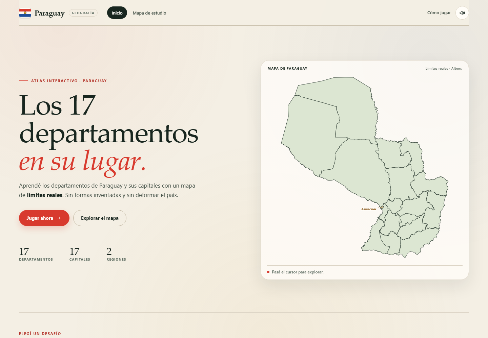
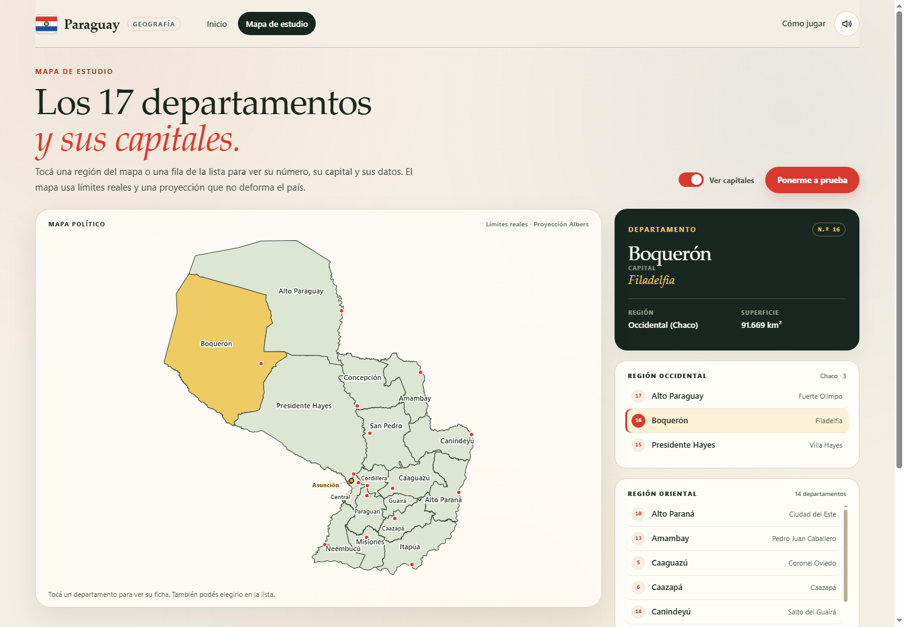

# Paraguay · Departamentos y capitales

Juego de geografía al estilo Seterra para aprender los **17 departamentos de Paraguay, sus capitales y su numeración nacional**. Incluye tres modos de juego, un mapa de estudio y récords guardados en el navegador.

El mapa no es un dibujo aproximado: usa **límites geográficos reales** y una proyección **Albers Equal Area** con una única escala, así que conserva la forma y la proporción del país.



## Cómo abrirla

No requiere instalación, servidor ni conexión a internet. Abrí `index.html` con doble clic en Chrome, Edge, Firefox o Safari.

Si preferís una URL local:

```powershell
python -m http.server 8080
# Abrí http://localhost:8080
```

## Cómo se juega

Cada partida baraja los 17 departamentos. Si fallás, el departamento vuelve a aparecer unas preguntas después: la partida termina cuando los 17 quedaron dominados.

- **Ubica el departamento**: te damos el nombre y hacés clic en la región correcta.
- **Ubica la capital**: te damos una capital y marcás su departamento.
- **Elige la capital**: el mapa ilumina un departamento y elegís su capital entre cuatro opciones.

El tiempo empieza al comenzar la partida. Al final se muestran el tiempo, los aciertos a la primera, los errores, la precisión y una lista para repasar. El **récord** de cada modo se guarda solo si completás la partida sin errores.

También hay un **mapa de estudio** con los nombres, los números departamentales, los puntos de las capitales y una ficha por departamento (número, capital, región y superficie), además de una lista agrupada por Región Occidental (Chaco) y Región Oriental.

**Asunción** aparece en el mapa como distrito capital, pero no se pregunta: no es un departamento.

### Atajos

- `Tab` recorre las regiones del mapa y las opciones.
- `Enter` o `Espacio` confirman.
- En el modo de opciones también se puede usar `1` a `4`.
- `Esc` cierra la ayuda.

## El mapa: por qué no está deformado

- **Fuente:** [geoBoundaries](https://www.geoboundaries.org/) `gbOpen` para Paraguay, nivel ADM1, archivo simplificado. Licencia **CC BY 4.0**; datos originales de la Dirección General de Estadística, Encuestas y Censos (DGEEC) de Paraguay, 2012.
- **Proyección:** Albers Equal Area con paralelos estándar en 20°S y 28°S, meridiano central 58,45°O y latitud de origen 23,44°S. Es una proyección adecuada para un país de extensión media como Paraguay.
- **Escala única:** el ancho y el alto del SVG derivan del mismo factor de escala. No se usa `preserveAspectRatio="none"` ni se estira el mapa para llenar un contenedor.
- **18 unidades:** 17 departamentos + Asunción. Cada departamento lleva su número nacional del 1 al 17; Asunción no tiene número. Las capitales se ubican con coordenadas y se validan contra el polígono correspondiente durante la generación.
- **Etiquetas:** se calculan dentro de cada polígono (aproximación de *polylabel*). Las etiquetas de Central y Asunción usan líneas guía porque son regiones muy pequeñas.

El archivo `map-data.js` se genera automáticamente; no conviene editarlo a mano.

## Numeración de departamentos

La página usa la **numeración nacional del 1 al 17**:

1 Concepción · 2 San Pedro · 3 Cordillera · 4 Guairá · 5 Caaguazú · 6 Caazapá · 7 Itapúa · 8 Misiones · 9 Paraguarí · 10 Alto Paraná · 11 Central · 12 Ñeembucú · 13 Amambay · 14 Canindeyú · 15 Presidente Hayes · **16 Boquerón** · **17 Alto Paraguay**.

Asunción no tiene número departamental porque es un distrito capital.

> Esta numeración no es la de los códigos **ISO 3166-2**. Para Boquerón y Alto Paraguay, ISO usa `PY-19` y `PY-16`; acá se usan 16 y 17 para que la serie 1–17 sea correlativa. El detalle también aparece en el diálogo «Cómo jugar».

La ficha, la lista, el tooltip del mapa y el feedback del juego muestran el número de cada departamento:



## Estructura

```text
index.html              Estructura de las pantallas
styles.css              Sistema visual, mapa, responsive y estados
app.js                  Rutas, render del SVG, juego, estudio, sonido y récords
game.js                 Lógica pura del juego (testable con Node)
map-data.js             Generado: paths SVG, números, etiquetas y puntos de capitales
preview.png             Captura de la pantalla de inicio
preview-estudio.png     Captura del mapa de estudio con la numeración
tools/build_map.py      Pipeline de límites reales → SVG
tools/data/             GeoJSON de origen cacheado
tests/game.test.mjs     Pruebas de la lógica de partida
tests/data.test.mjs     Pruebas de integridad del mapa, los pares y la numeración
tests/e2e.mjs           Prueba de humo en Chrome o Edge (CDP)
```

## Reconstruir el mapa

Requiere Python 3.10 o superior. La primera vez descarga el GeoJSON desde geoBoundaries; luego usa la copia cacheada en `tools/data/`.

```powershell
python tools/build_map.py            # regenera map-data.js
python tools/build_map.py --check    # verifica que esté actualizado
python tools/build_map.py --refresh  # vuelve a descargar la fuente
```

Los datos de departamentos, números, capitales, regiones y superficies están en `tools/build_map.py` (`DEPARTMENTS` y `NATIONAL_NUMBERS`). Si los cambiás, volvé a generar `map-data.js`.

## Pruebas

### Lógica y datos

```powershell
node --test tests/*.test.mjs
```

Verifica los 17 pares departamento-capital, la integridad de los polígonos, la proporción del mapa, el reencolado de fallos, las opciones del modo capitales y el formato del tiempo.

### Prueba de humo en el navegador

Requiere Node 22 o superior (usa `WebSocket` nativo) y Chrome o Edge. Abrí una instancia con depuración remota **usando un perfil temporal** (la prueba limpia el `localStorage` de ese perfil):

```powershell
& "C:\Program Files\Google\Chrome\Application\chrome.exe" `
  --headless=new --no-sandbox --remote-debugging-port=9333 `
  --user-data-dir="$env:TEMP\py-e2e-profile" about:blank
```

Si usás Edge, cambiá la ruta por `C:\Program Files (x86)\Microsoft\Edge\Application\msedge.exe` y agregá `--remote-allow-origins=*`.

En otra terminal:

```powershell
node tests/e2e.mjs
```

La prueba recorre una partida completa de cada modo, comprueba un fallo y su reencolado, el mapa de estudio, el aviso de Asunción, los récords y la consola, y guarda capturas en `tools/` mientras se ejecuta.

## Personalizar

- **Colores y tipografía:** variables al inicio de `styles.css`.
- **Textos y modos:** `index.html`, `app.js` y `game.js`.
- **Datos del mapa:** `DEPARTMENTS` en `tools/build_map.py`; después ejecutá el generador.
- **Récords:** se guardan en `localStorage` con las claves `py-geo:records:v1`, `py-geo:sound:v1` y `py-geo:capitals:v1`.
- **Sin dependencias externas:** no hay CDN, fuentes remotas ni tiles. Todo funciona desde el sistema de archivos.

## Datos y licencias

- Límites: geoBoundaries, licencia CC BY 4.0. Fuente original: DGEEC Paraguay, 2012.
- Capitales y superficies: [Departamentos de Paraguay](https://es.wikipedia.org/wiki/Departamentos_de_Paraguay) (Wikipedia), datos del censo 2022.

La atribución también aparece en el pie de la página y en el diálogo «Cómo jugar».
